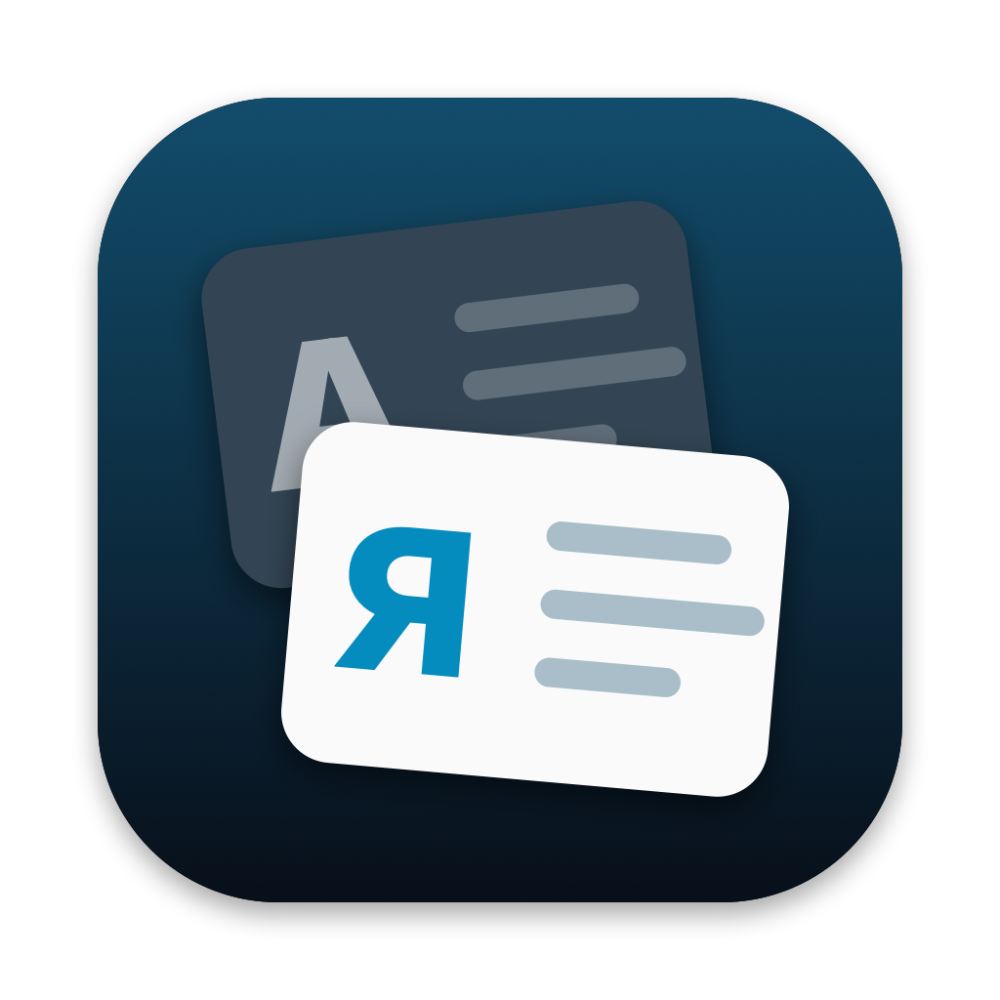
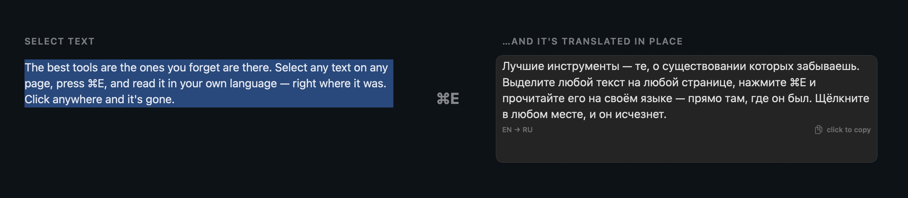
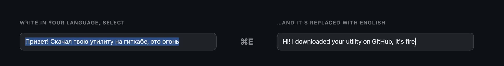

<p align="center">
  
</p>

<h1 align="center">Overtext</h1>

<p align="center">
  <b>Select text anywhere on your Mac, press ⌘E — and read it in your language, right where it was.</b><br>
  A free, open-source translator for macOS. No windows, no copy-paste.
</p>

<p align="center">
  <a href="https://github.com/markdevjester/Overtext/releases/latest">Download</a> ·
  <a href="#how-it-works">How it works</a> ·
  <a href="#privacy">Privacy</a> ·
  <a href="README.ru.md">Русский</a>
</p>

<p align="center">
  
</p>

## How it works

**Read anything in your language.** Select a paragraph in Safari, Chrome, Mail, Notes or almost any other app and press **⌘E**. The translation appears right on top of the original — same place, same font size. Click anywhere, scroll or press any key, and it's gone. Click the translation itself to copy it.

**Write in your language, send in another.** In any text field — a Reddit post, a chat, an email — write in your own language, select it and press **⌘E**. The text is replaced with the translation right in the field. **⌘Z** brings the original back.

<p align="center">
  
</p>

**Names stay names.** Brand names written the way they sound — *эпстор*, *айфон*, *гитхаб* — become App Store, iPhone and GitHub instead of nonsense like "epstor". Add your own words in the menu bar icon → **My Dictionary…** (one rule per line: `how I write = how it should be`).

**When an app doesn't say where the text is**, the translation slides out of the notch instead.

<p align="center">
  
</p>

<sub>Screenshots show real pages from German and Spanish Wikipedia (text and images CC BY-SA 4.0) with Overtext's own card rendered on top. They are made by `Tools/SiteShots` without capturing the screen.</sub>

## Install

1. Download `Overtext-1.0.1.zip` from [Releases](https://github.com/markdevjester/Overtext/releases/latest), unzip, and move `Overtext.app` to **Applications**.
2. First launch: the app isn't notarized by Apple yet, so macOS will say it can't verify the developer. Open **System Settings → Privacy & Security**, scroll down and click **Open Anyway**.
3. Allow Overtext in **System Settings → Privacy & Security → Accessibility** — it needs this to read the selected text and to paste the translation. Then quit and reopen it from the menu bar icon.
4. Select some text and press **⌘E**.

**Languages.** By default, foreign text is translated into your system language, and text in your language is translated into English. Change both in the menu bar icon → **Translate into** and **My own text into**. 14 languages: English, Russian, Ukrainian, German, French, Spanish, Italian, Portuguese, Polish, Turkish, Chinese, Japanese, Korean, Arabic.

Requires macOS 14 or later. Apple Silicon and Intel.

## Privacy

- The selected text is sent to **Google Translate** to be translated — nothing else, and only when you press ⌘E. Don't use it on text you wouldn't paste into translate.google.com.
- Overtext has no account, no analytics and no servers of its own.
- When an app doesn't expose the selection, Overtext copies it with ⌘C and puts your clipboard back right after. Those temporary copies are marked as transient, so clipboard managers (including [NotchStash](https://github.com/markdevjester/NotchStash)) skip them.
- A short debug log (app name and what was detected — never the text) is kept in `~/Library/Logs/Overtext.log`.

## Good to know

- **⌘E is taken system-wide** while Overtext runs (in Finder it was "Eject", in browsers "Use Selection for Find").
- Chrome, Arc, Edge and Electron apps expose page text only on request; Overtext asks for it when you switch to them, so the very first ⌘E there may slide out of the notch instead of appearing in place.
- Translation quality is Google's. If a name gets translated as a word, add it to your dictionary.

## Build from source

No Xcode project needed — just Swift (Xcode or Command Line Tools):

```bash
git clone https://github.com/markdevjester/Overtext.git
cd Overtext
zsh build.sh --install   # build a universal app and copy it to /Applications
```

If you have a code-signing certificate named `markdev` in your keychain, the build uses it, so the Accessibility permission survives rebuilds; otherwise it signs ad-hoc.

Tests (Google response parsing, language direction, name dictionary):

```bash
swiftc -swift-version 5 Sources/Translator.swift Sources/Glossary.swift Tests/main.swift -o /tmp/overtext-test && /tmp/overtext-test
```

## Roadmap

- Pick your own shortcut
- Keep names untranslated in the other direction too
- On-device translation option (Apple Translation)
- Signed and notarized builds, Homebrew cask

## License

[MIT](LICENSE) © 2026 markdev. Also by markdev: [NotchStash](https://github.com/markdevjester/NotchStash) — a clipboard manager that lives in your notch.
