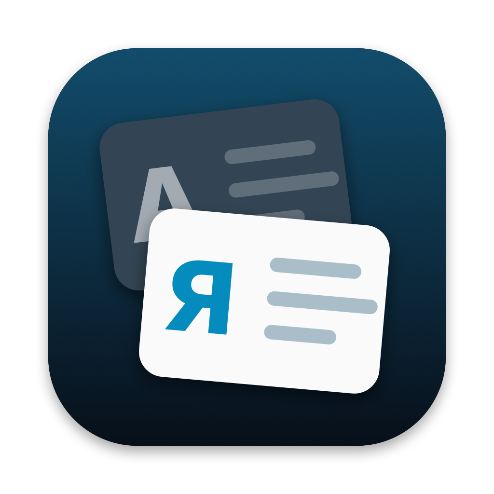
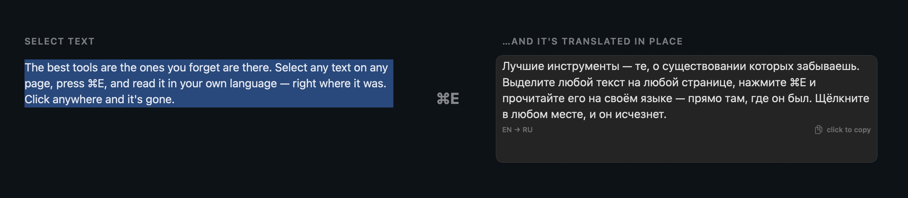
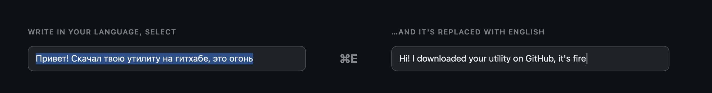

<p align="center">
  
</p>

<h1 align="center">Overtext</h1>

<p align="center">
  <b>Выделите текст где угодно на Mac, нажмите ⌘E — и читайте его на своём языке прямо там, где он был.</b><br>
  Бесплатный переводчик для macOS с открытым кодом. Без окон и копирования.
</p>

<p align="center">
  <a href="https://github.com/markdevjester/Overtext/releases/latest">Скачать</a> ·
  <a href="#как-это-работает">Как это работает</a> ·
  <a href="#приватность">Приватность</a> ·
  <a href="README.md">English</a>
</p>

<p align="center">
  
</p>

## Как это работает

**Читайте что угодно на своём языке.** Выделите абзац в Safari, Chrome, Почте, Заметках или почти любой другой программе и нажмите **⌘E**. Перевод появится прямо поверх оригинала — на том же месте, тем же размером шрифта. Клик в любом месте, прокрутка или любая клавиша — и его нет. Клик по самому переводу копирует его.

**Пишите на своём языке, отправляйте на другом.** В любом поле ввода — пост на Reddit, чат, письмо — напишите по-русски, выделите и нажмите **⌘E**. Текст заменится переводом прямо в поле. **⌘Z** вернёт оригинал.

<p align="center">
  
</p>

**Названия остаются названиями.** То, что пишут на слух — *эпстор*, *айфон*, *гитхаб*, — превращается в App Store, iPhone и GitHub, а не в «epstor». Свои слова можно добавить: значок в строке меню → **Мой словарь названий…** (одно правило на строку: `как пишу = как должно быть`, падежи учитываются сами).

**Если программа не сообщает, где выделенный текст**, перевод выезжает из чёлки.

<p align="center">
  
</p>

<sub>На картинках — настоящие страницы немецкой и испанской Википедии (тексты и фото CC BY-SA 4.0) с карточкой Overtext поверх. Их собирает `Tools/SiteShots` без захвата экрана.</sub>

## Установка

1. Скачайте `Overtext-1.0.0.zip` из [Releases](https://github.com/markdevjester/Overtext/releases/latest), распакуйте и перенесите `Overtext.app` в **Программы**.
2. Первый запуск: приложение пока не заверено Apple, поэтому macOS скажет, что не может проверить разработчика. Откройте **Системные настройки → Конфиденциальность и безопасность**, прокрутите вниз и нажмите **«Всё равно открыть»**.
3. Разрешите Overtext в **Системные настройки → Конфиденциальность и безопасность → Универсальный доступ** — так он читает выделенный текст и вставляет перевод. Потом закройте его через значок в строке меню и откройте снова.
4. Выделите текст и нажмите **⌘E**.

**Языки.** По умолчанию чужой текст переводится на язык системы, а текст на вашем языке — на английский. Оба меняются в значке в строке меню → **Переводить на** и **Свой текст — на**. 14 языков: английский, русский, украинский, немецкий, французский, испанский, итальянский, португальский, польский, турецкий, китайский, японский, корейский, арабский.

Нужна macOS 14 или новее. Apple Silicon и Intel.

## Приватность

- Выделенный текст отправляется в **Google Переводчик** — только он и только когда вы нажали ⌘E. Не переводите им то, что не стали бы вставлять на translate.google.com.
- У Overtext нет аккаунта, аналитики и своих серверов.
- Если программа не отдаёт выделение, Overtext копирует его через ⌘C и сразу возвращает буфер обмена как было. Такие временные копии помечены, и менеджеры буфера (в том числе [NotchStash](https://github.com/markdevjester/NotchStash)) их не сохраняют.
- Короткий журнал для отладки (название программы и что распознано — без текста) лежит в `~/Library/Logs/Overtext.log`.

## Полезно знать

- **⌘E занят во всей системе**, пока Overtext запущен (в Finder это было «Извлечь», в браузерах — «Искать выделенное»).
- Chrome, Arc, Edge и программы на Electron отдают текст страниц только по просьбе; Overtext просит при переключении на них, поэтому самое первое ⌘E там может выехать из чёлки, а не появиться на месте.
- Качество перевода — как у Google. Если имя переводится как слово, добавьте его в свой словарь.

## Сборка из исходников

Проект Xcode не нужен — только Swift (Xcode или Command Line Tools):

```bash
git clone https://github.com/markdevjester/Overtext.git
cd Overtext
zsh build.sh --install   # собрать универсальное приложение и положить в /Applications
```

Если в Связке ключей есть сертификат подписи кода с именем `markdev`, сборка подписывает им — тогда «Универсальный доступ» не слетает после пересборки; иначе подпись ad-hoc.

Тесты (разбор ответа Google, направление перевода, словарь названий):

```bash
swiftc -swift-version 5 Sources/Translator.swift Sources/Glossary.swift Tests/main.swift -o /tmp/overtext-test && /tmp/overtext-test
```

## Планы

- Своё сочетание клавиш
- Не переводить имена и в обратную сторону
- Перевод на устройстве (Apple Translation)
- Подписанные и заверенные сборки, Homebrew

## Лицензия

[MIT](LICENSE) © 2026 markdev. Ещё от markdev: [NotchStash](https://github.com/markdevjester/NotchStash) — менеджер буфера обмена в чёлке.
